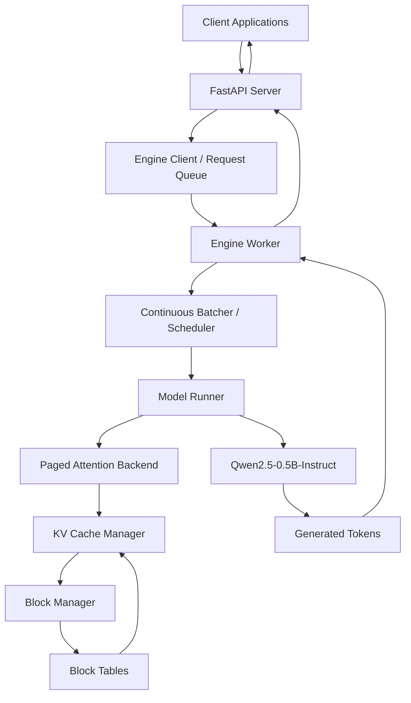

# PagedServe

### A From-Scratch LLM Inference Engine with Continuous Batching and a Paged KV Cache

PagedServe is an experimental, memory-conscious large language model (LLM) inference engine built to explore the systems behind efficient LLM serving on consumer hardware. It implements request scheduling, continuous batching, paged key-value (KV) caching, GPU-backed generation, and an inference API.

The project focuses on understanding and implementing the mechanisms that allow multiple generation requests to share GPU compute and KV-cache memory efficiently, rather than treating inference as a sequence of independent model calls.

**Primary model:** Qwen2.5-0.5B-Instruct  
**Target GPU:** NVIDIA RTX 3050 Laptop GPU (4 GB VRAM)  
**Runtime:** Python, PyTorch, FastAPI, WSL2 Ubuntu 24.04

> **Project status:** Experimental research implementation. Core inference, scheduling, paged KV-cache, API, and benchmarking components are implemented. Triton acceleration is experimental, and full-model numerical equivalence between backends is not yet guaranteed.

---

## Table of Contents

- [Motivation](#motivation)
- [Project Goals](#project-goals)
- [Architecture](#architecture)
- [Core Components](#core-components)
- [Features](#features)
- [Technology Stack](#technology-stack)
- [Benchmark Results](#benchmark-results)
- [Numerical Correctness](#numerical-correctness)
- [API](#api)
- [Installation and Usage](#installation-and-usage)
- [Testing](#testing)
- [Limitations](#limitations)
- [Roadmap](#roadmap)
- [Project Structure](#project-structure)
- [Design Philosophy](#design-philosophy)

---

## Motivation

LLM inference is not only a model-computation problem. Its performance depends on how requests are scheduled, how tokens are generated, and how intermediate attention state is stored and reused.

A conventional inference loop can leave GPU resources underutilized when requests have different prompt lengths or generation lengths. Static batching improves utilization, but requests in a batch can finish at different times, leaving compute capacity unused.

KV-cache allocation introduces another challenge. As sequences grow, storing their key and value tensors can consume substantial memory. Contiguous allocation can also introduce fragmentation and make dynamic request admission more difficult.

PagedServe explores these problems through a small, inspectable inference engine designed for a resource-constrained environment.

The primary questions are:

1. Can iteration-level scheduling improve throughput over processing requests independently?
2. Can a block-based KV cache support dynamic sequence lengths without requiring one contiguous allocation per sequence?
3. How should scheduling, memory allocation, and attention interact during generation?
4. What are the trade-offs between numerical correctness, memory use, and custom GPU-kernel performance?
5. How can these systems be benchmarked reproducibly on a consumer GPU?

## Project Goals

- Implement continuous, iteration-level batching.
- Build a block-based paged KV-cache manager.
- Map logical sequence positions to physical KV-cache blocks.
- Support request scheduling and cancellation.
- Explore preemption through recomputation.
- Expose inference through an HTTP API.
- Compare sequential, static-batch, and continuous-batching workloads.
- Evaluate a custom Triton paged-decode attention backend.
- Record latency, throughput, memory consumption, and correctness results.

The focus is on inference-system design and measurement—not on training a language model.

---

## Architecture

PagedServe separates the serving layer from the engine's scheduling, model-execution, and memory-management responsibilities.



### Request lifecycle

1. **Request admission:** The API accepts a generation request and forwards it to the engine.
2. **Queueing:** The request enters the engine's request-management path.
3. **Scheduling:** The scheduler determines which active requests participate in the next execution iteration.
4. **Prefill:** The model processes the prompt and initializes the sequence's KV state.
5. **Decode:** The engine generates tokens incrementally, reusing previously computed key and value tensors.
6. **Cache management:** Logical sequence positions are resolved through block tables to physical cache blocks.
7. **Completion or cancellation:** The request finishes or is cancelled, and its allocated cache resources are released.

The scheduler, cache manager, and model runner are separate components so that their behavior can be tested and measured independently.

### Design principles

- **Single-owner GPU execution:** GPU-side model and cache state are managed through a dedicated engine execution path.
- **Explicit memory management:** KV-cache blocks are allocated and released through a block manager.
- **Iteration-level scheduling:** Active requests can be reconsidered between generation iterations.
- **Backend separation:** Attention implementations can be compared without treating experimental kernels as automatically equivalent to the reference implementation.
- **Measurement before optimization:** Every performance claim should identify its workload, measurement scope, and correctness constraints.

---

## Core Components

### 1. Continuous batching and scheduling

PagedServe supports concurrent generation requests through an iteration-level batching design.

Instead of waiting for every request in a fixed batch to finish, the engine can reconsider active work at generation boundaries. This is intended to improve utilization when requests have different completion times.

The scheduler and continuous batcher are covered by unit and integration tests.

**Measured result:** In the tested workload, throughput increased from approximately 23.40 tokens/s at concurrency 1 to 35.34 tokens/s at concurrency 8, or about **1.51×**.

This result is specific to the tested workload and should not be interpreted as a universal scaling factor.

### 2. Paged KV cache

The KV cache stores attention keys and values for tokens that have already been processed.

PagedServe divides cache storage into fixed-size blocks rather than requiring each sequence to occupy one contiguous memory region.

The cache-management path includes:

- Physical block allocation and release.
- Logical-to-physical block mapping.
- Per-sequence block tables.
- Cache-capacity accounting.
- Tests for allocation correctness and cleanup.

For the configured Qwen2.5-0.5B model, the expected KV-cache footprint is approximately **12 KiB per token** at BF16 precision.

With 16-token blocks:

- KV-cache memory per block: approximately 192 KiB.
- Configured pool of 128 blocks: approximately 24 MiB.
- Total logical token slots in that pool: 2,048.

These are configuration and tensor-size calculations, not measurements of total GPU memory consumption.

### 3. Paged attention

Paged attention resolves each sequence's logical token positions through its block table, allowing attention to access KV tensors stored across multiple physical blocks.

PagedServe includes a PyTorch reference path and an experimental Triton paged-decode implementation.

The reference implementation is useful for correctness testing. The Triton path explores the performance potential of a specialized GPU kernel, but full-model numerical parity remains an open issue.

### 4. Model execution

The primary model is Qwen2.5-0.5B-Instruct.

The engine supports model execution, prefill, incremental decode, and the KV-cache operations needed to maintain generation state.

The current project evaluates the engine in BF16 and uses FP32 in selected experiments to investigate numerical differences.

### 5. Serving API

The FastAPI application exposes health checks, request submission, request-status retrieval, cancellation, and a convenience generation endpoint.

The serving layer is designed to keep HTTP request handling separate from the model execution path.

---

## Features

| Feature | Status |
|---|---|
| Qwen2.5-0.5B-Instruct inference | Implemented and tested |
| Block-based paged KV cache | Implemented |
| Block tables and allocation management | Implemented and tested |
| PyTorch paged attention | Implemented |
| Continuous-batching scheduler | Implemented and tested |
| Concurrent request handling | Implemented and tested |
| Request cancellation | API endpoint implemented |
| FastAPI inference endpoints | Implemented and tested |
| Sequential Hugging Face baseline | Benchmarked |
| Static batching baseline | Benchmarked |
| KV-cache fragmentation analysis | Analytical benchmark completed |
| Triton paged-decode kernel | Implemented and microbenchmarked |
| Triton full-model integration | Experimental; parity issues remain |
| Streaming token delivery | Not yet implemented as a streaming API |
| Production-grade preemption/recomputation | Requires further validation |
| Prometheus-compatible metrics | Not implemented |

Feature status describes the current implementation and available validation; it does not imply production readiness.

---

## Technology Stack

| Technology | Purpose |
|---|---|
| Python | Engine and scheduling implementation |
| PyTorch | Tensor operations and reference attention |
| Hugging Face Transformers | Model loading and baseline inference |
| FastAPI | HTTP serving layer |
| Pydantic | API request and response validation |
| Triton | Experimental custom GPU kernels |
| pytest | Unit and integration testing |
| CUDA | GPU execution |
| WSL2 / Ubuntu 24.04 | Development and runtime environment |

---

## Benchmark Results

The benchmarks below were collected on the target development setup. Results are workload-specific and should be reproduced before drawing broader conclusions.

### Hardware and model

| Property | Configuration |
|---|---|
| GPU | NVIDIA RTX 3050 Laptop GPU |
| VRAM | 4 GB |
| CPU | Intel Core i5-12500H |
| System RAM | 16 GB |
| Runtime | WSL2 Ubuntu 24.04 |
| Model | Qwen2.5-0.5B-Instruct |
| Precision | BF16 for the primary experiments; FP32 for selected numerical checks |

### 1. Sequential Hugging Face baseline

Five-repeat baseline using `max_new_tokens=32`.

| Prompt category | Prompt tokens | Mean latency | Median latency | Throughput | Peak GPU memory |
|---|---:|---:|---:|---:|---:|
| Short | 5 | 825.0 ms | 831.3 ms | 38.79 tok/s | 961.33 MiB |
| Medium | 19 | 807.0 ms | 818.4 ms | 39.65 tok/s | 961.50 MiB |
| Long | 48 | 828.1 ms | 835.8 ms | 38.64 tok/s | 961.85 MiB |

The measurements provide a reference for sequential generation under the tested configuration.

### 2. PagedServe single-request measurements

| Prompt category | Throughput | Prefill latency | Time to first token | Time per output token | Peak GPU memory |
|---|---:|---:|---:|---:|---:|
| Short | 31.05 tok/s | 55.23 ms | 56.35 ms | 31.32 ms | 984.75 MiB |
| Medium | 24.14 tok/s | 202.28 ms | 202.43 ms | 36.13 ms | 988.81 MiB |
| Long | 16.77 tok/s | 610.99 ms | 611.16 ms | 41.72 ms | 997.30 MiB |

**Interpretation:** The current measurements show that prompt length substantially affects PagedServe's prefill latency and single-request throughput. PagedServe is not faster than the sequential Hugging Face baseline on every tested workload.

These results are not a strict apples-to-apples performance comparison: the implementations use different execution paths, and the reported measurements should not be treated as proof of an overall speedup.

### 3. Continuous-batching throughput

Measured throughput for a workload with different numbers of concurrent requests.

| Concurrency | Throughput | Peak GPU memory |
|---:|---:|---:|
| 1 | 23.40 tok/s | 984.75 MiB |
| 2 | 29.07 tok/s | 989.28 MiB |
| 4 | 32.44 tok/s | 1,002.06 MiB |
| 8 | 35.34 tok/s | 1,002.06 MiB |

At concurrency 8, throughput reached approximately **1.51× the concurrency-1 result**. The improvement is sublinear, and the observed result applies only to this benchmark configuration.

The benchmark also checked request completion, cache cleanup, and decode-batch consistency for the tested workload.

### 4. Static batching

BF16 experiments used five repeats per batch size.

| Batch size | Throughput | Per-request latency | Peak GPU memory | Token parity |
|---:|---:|---:|---:|---|
| 1 | 39.18 tok/s | 816.82 ms | 961.33 MiB | Passed |
| 2 | 73.25 tok/s | 436.83 ms | 964.69 MiB | Failed |
| 3 | 112.89 tok/s | 283.47 ms | 968.93 MiB | Failed |

Static batching improved throughput as batch size increased, but BF16 numerical differences caused token sequences to diverge for some larger batches.

A separate FP32 experiment with three repeats produced:

| Batch size | Throughput | Per-request latency | Peak GPU memory | Token parity |
|---:|---:|---:|---:|---|
| 1 | 20.84 tok/s | 1,535.60 ms | 1,897.15 MiB | Passed |
| 2 | 46.07 tok/s | 694.60 ms | 1,902.63 MiB | Passed |
| 3 | 86.33 tok/s | 370.66 ms | 1,907.67 MiB | Passed |

The FP32 experiment illustrates a numerical-stability trade-off: parity passed for these tested cases, with higher latency and memory consumption. It does not establish parity for every prompt or configuration.

### 5. Triton paged-decode microbenchmark

The isolated paged-decode benchmark reported:

| Implementation | Median latency | Mean latency |
|---|---:|---:|
| Vectorized PyTorch reference | 8.104 ms | 9.579 ms |
| Triton kernel | 0.254 ms | 0.270 ms |

This corresponds to roughly **31.9× lower median latency** for the measured kernel workload.

The comparison is a microbenchmark, not an end-to-end model speedup. It compares the tested implementations under the benchmark's scope; it does not include all model projections, the entire generation loop, or every serving overhead.

The Triton matrix benchmark also passed its numerical checks for the tested kernel cases, with a reported maximum absolute error of approximately 0.01074.

### 6. Integrated PyTorch versus Triton backend

The following measurements include the integrated engine workload, rather than only the isolated attention kernel.

| Concurrency | Backend | Request latency | Request throughput | Token throughput | Peak GPU memory |
|---:|---|---:|---:|---:|---:|
| 1 | PyTorch | 0.986 s | 1.01 req/s | 32.47 tok/s | 1,008.8 MiB |
| 1 | Triton | 0.867 s | 1.15 req/s | 36.91 tok/s | 1,008.8 MiB |
| 2 | PyTorch | 1.620 s | 1.23 req/s | 39.51 tok/s | 1,008.8 MiB |
| 2 | Triton | 1.076 s | 1.86 req/s | 59.46 tok/s | 1,008.8 MiB |
| 4 | PyTorch | 2.568 s | 1.56 req/s | 49.84 tok/s | 1,008.8 MiB |
| 4 | Triton | 1.295 s | 3.09 req/s | 98.88 tok/s | 1,008.8 MiB |
| 8 | PyTorch | 4.365 s | 1.83 req/s | 58.65 tok/s | 1,008.8 MiB |
| 8 | Triton | 1.866 s | 4.29 req/s | 137.20 tok/s | 1,013.1 MiB |

The integrated Triton path achieved **137.20 tok/s at concurrency 8** in the tested workload.

However, the integrated backend did not preserve exact output parity for every tested concurrency: equality passed at concurrency 2 but failed at 1, 4, and 8. Therefore, these results demonstrate performance potential, not a verified drop-in replacement for the PyTorch path.

### 7. KV-cache fragmentation analysis

The analytical fragmentation experiment compared different block sizes.

| Block size | Blocks required | Reserved token slots | Unused slots | Unused-slot ratio | Estimated KV memory |
|---:|---:|---:|---:|---:|---:|
| 4 | 1,104 | 4,416 | 4 | 0.09% | 51.750 MiB |
| 8 | 553 | 4,424 | 12 | 0.27% | 51.844 MiB |
| 16 | 278 | 4,448 | 36 | 0.81% | 52.125 MiB |
| 32 | 141 | 4,512 | 100 | 2.22% | 52.875 MiB |

For this analytical workload, smaller blocks reduced unused token slots. The trade-off is that smaller blocks require more block-management metadata and potentially more bookkeeping.

These are analytical allocation results, not measurements of end-to-end performance or a direct comparison against a contiguous-cache engine.

### Benchmark interpretation

Taken together, the experiments show three things:

1. Continuous batching improved aggregate throughput in the tested concurrent workload.
2. A custom Triton paged-decode kernel can substantially reduce latency in the isolated kernel benchmark.
3. Numerical equivalence is a first-class systems concern: kernel speedups are useful only when correctness requirements are also satisfied.

The results do **not** establish that PagedServe universally outperforms Hugging Face Transformers or production inference engines. A controlled, end-to-end comparison with equivalent workloads, output lengths, warm-up, precision, and timing boundaries remains necessary.

Benchmark artifacts are stored under `bench/results/`.

---

## Numerical Correctness

PagedServe treats correctness as separate from performance.

The validation suite includes:

- KV-cache allocation and release tests.
- Block-table mapping tests.
- Paged-attention tests.
- Scheduler and continuous-batcher tests.
- Model-generation integration tests.
- API tests.
- Triton kernel parity tests.
- Token-sequence validation scripts.

Exact token-sequence parity was verified for three prompts in a dedicated validation run, and the associated KV-cache allocations were released.

This result is limited to those prompts and that configuration. It does not establish universal parity between all backends.

BF16 batched generation and the integrated Triton backend have known numerical-equivalence limitations. Near-tied logits can produce different selected tokens even when individual logits differ only slightly.

The full-model Triton integration test is currently marked as an expected failure while the numerical discrepancy is investigated. The assertion remains in the test suite; it has not been removed to make the suite pass.

---

## API

The FastAPI application currently exposes the following endpoints.

| Method | Endpoint | Purpose |
|---|---|---|
| `GET` | `/health` | Health check |
| `GET` | `/healthz` | Alternative health check |
| `POST` | `/v1/requests` | Submit a generation request |
| `GET` | `/v1/requests/{request_id}` | Retrieve request status |
| `DELETE` | `/v1/requests/{request_id}` | Cancel a request |
| `POST` | `/v1/generate` | Convenience generation endpoint |

### Example: health check

```bash
curl http://127.0.0.1:8000/health
```

### Example: submit a generation request

The exact accepted request fields are defined by the API schema. A typical request is:

```bash
curl -X POST http://127.0.0.1:8000/v1/requests \
  -H "Content-Type: application/json" \
  -d '{
    "prompt": "Explain paged attention in simple terms.",
    "max_new_tokens": 64
  }'
```

Use the returned request identifier to query the request-status endpoint.

### Streaming status

The project goal includes streaming inference, but a streaming token-delivery endpoint is not yet implemented. The current request/status API should not be described as SSE or WebSocket streaming.

---

## Installation and Usage

### Prerequisites

- Ubuntu 24.04 or a compatible Linux environment.
- Python and pip.
- An NVIDIA GPU with a compatible driver and CUDA-enabled PyTorch installation for GPU execution.
- Sufficient disk space to download the model and dependencies.

The development environment used for the main experiments is WSL2 Ubuntu 24.04 on an RTX 3050 Laptop GPU with 4 GB VRAM.

### 1. Clone the repository

```bash
git clone https://github.com/Subhajit281/pagedserve.git
cd pagedserve
```

### 2. Create a virtual environment

```bash
python3 -m venv .venv
source .venv/bin/activate

python -m pip install --upgrade pip
```

### 3. Install dependencies

If a project dependency file is provided:

```bash
pip install -r requirements-lock.txt
```

Install a CUDA-compatible PyTorch build appropriate for your environment before running GPU workloads if the dependency file does not provide the required build.

### 4. Run the test suite

```bash
pytest -q
```

### 5. Start the API

Use the application's actual import path and configuration. For the current FastAPI layout, the typical command is:

```bash
uvicorn pagedserve.server.app:app --host 0.0.0.0 --port 8000
```

If the application requires model paths, device settings, or other environment variables, configure them according to the current source and model-loading setup.

### 6. Run a benchmark

Benchmark entry points and generated result files are under `bench/` and `scripts/`. Inspect the script's arguments before running it, as some benchmarks load the model and consume substantial GPU memory.

---

## Testing

The most recently recorded full test-suite result was:

```text
128 passed, 1 xfailed, 1 warning
```

The expected failure is the known full-model Triton numerical-parity issue. The warning concerns a Starlette test-client deprecation.

The suite covers the API, request handling, block allocation, KV cache, scheduler, paged attention, model integration, and Triton-related components.

A passing test suite demonstrates that the covered cases pass; it is not a substitute for long-running stress tests, production deployment testing, or exhaustive numerical validation.

---

## Limitations

PagedServe is a systems-engineering prototype, not a production-ready replacement for established inference servers.

### Numerical equivalence

- BF16 batched execution can produce different token sequences from the reference execution path.
- The integrated Triton backend has unresolved full-model output-parity issues.
- Kernel-level parity does not guarantee full-model parity.

### Performance evaluation

- Benchmarks use a small model and a specific consumer GPU.
- The isolated Triton microbenchmark does not represent end-to-end speedup.
- Some baseline comparisons use different execution paths and are not strictly apples-to-apples.
- The fragmentation experiment is analytical, not an end-to-end allocator benchmark.
- Performance can vary with prompt length, output length, concurrency, precision, warm-up, and hardware.

### Serving capabilities

- Streaming token delivery is not implemented.
- Production-grade preemption and recomputation require additional validation.
- Prometheus-compatible metrics are not implemented.
- The current API does not establish production guarantees for authentication, multi-tenant isolation, or deployment security.

### Scope

The current project targets a single GPU and a small decoder-only language model. Multi-GPU execution, speculative decoding, quantization, LoRA serving, and multimodal inference are outside the current implementation scope.

---

## Roadmap

### Completed or implemented

- [x] Model-loading and inference foundations.
- [x] Sequential Hugging Face baseline.
- [x] Block-based paged KV-cache management.
- [x] Block tables and allocation tests.
- [x] PyTorch paged-attention reference path.
- [x] Continuous-batching scheduler.
- [x] Request submission, status, and cancellation API.
- [x] Static-batching and concurrency benchmarks.
- [x] Triton paged-decode kernel prototype.
- [x] Benchmark result artifacts and correctness tests.

### In progress

- [ ] Resolve full-model numerical parity for Triton.
- [ ] Validate preemption and recomputation under realistic mixed workloads.
- [ ] Add token-level streaming delivery.
- [ ] Add structured runtime metrics and latency histograms.
- [ ] Establish a stricter apples-to-apples baseline protocol.
- [ ] Expand correctness testing across prompts, lengths, and concurrency levels.

### Future work

- [ ] Compare paged KV caching against a contiguous-cache implementation.
- [ ] Add long-running load and cache-pressure tests.
- [ ] Evaluate more sophisticated scheduling policies.
- [ ] Investigate quantization and other memory-saving techniques.
- [ ] Compare with an established inference server such as vLLM under matched conditions.

---

## Project Structure

```text
pagedserve/
├── pagedserve/
│   ├── attention/       # Paged attention implementations
│   ├── engine/          # Scheduling and cache-related engine components
│   ├── model/           # Model execution and inference engine
│   └── server/          # FastAPI application
├── bench/
│   └── results/         # Recorded benchmark artifacts
├── scripts/             # Validation and benchmark scripts
├── tests/
│   ├── api/
│   ├── integration/
│   └── unit/
├── requirements-lock.txt
├── README.md
└── .gitignore
```

The exact layout may evolve as components are refined.

---

## Design Philosophy

PagedServe is built around a simple principle:

**An inference engine should be evaluated not only by how fast it generates tokens, but also by how it schedules work, manages memory, preserves correctness, and explains its measurements.**

The project emphasizes transparent implementation, explicit cache management, reproducible experiments, and honest reporting of limitations.

Its current results show promising throughput improvements from continuous batching and an experimental Triton kernel, while also exposing the numerical and engineering challenges that remain before those optimizations can be treated as reliable production features.

PagedServe is an ongoing exploration of LLM serving systems on constrained hardware.

---

## License

Add the repository's chosen open-source license before describing PagedServe as open-source software. The model's weights and associated terms remain subject to the model provider's license and usage conditions.

## Acknowledgements

PagedServe builds on the Python, PyTorch, Hugging Face Transformers, FastAPI, and Triton ecosystems. The project is an independent implementation and should not be interpreted as an official implementation of any external inference engine.
